  
  &nbsp;
  
  &nbsp;
  

  CS student at <b>Newton School of Technology</b>, Bengaluru. I design AI systems that route work across models, 
  call tools, and keep a human approving the decisions that matter.

  <code>Python</code> <code>FastAPI</code> <code>SQLite</code> <code>Gemini</code> <code>Groq</code> <code>Ollama</code> <code>OpenRouter</code>
  <code>RAG</code> <code>function calling</code> <code>n8n</code> <code>Zapier</code> <code>REST</code> <code>webhooks</code>
  <code>Linux</code> <code>Git</code>

